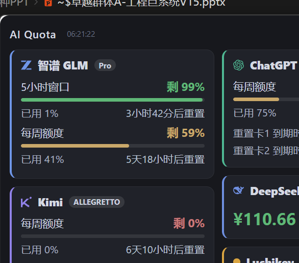

# AI Quota Desk

**Your AI coding quotas, one glance away.**

[](https://github.com/Yu-tao-Li/ai-quota-desk/releases/latest)   [](LICENSE)

**语言 / Language:** [简体中文](#简体中文) · [English](#english)

[下载 Windows 版 / Download](https://github.com/Yu-tao-Li/ai-quota-desk/releases/latest/download/ai-quota-desk-windows-x64.exe) · [Releases](https://github.com/Yu-tao-Li/ai-quota-desk/releases) · [Issues](https://github.com/Yu-tao-Li/ai-quota-desk/issues)

---

## 简体中文

把 GLM、Kimi、ChatGPT / Codex 的套餐额度，以及 DeepSeek、Luchikey 的账户余额，放进一张置顶桌面悬浮窗。写代码时抬眼就能看到**还剩多少、何时重置、哪张重置卡即将到期**。

**5 类在线数据源 · Codex 多账号 · Claude 本地日历与缓存 · 托盘后台刷新**

[界面预览](#界面预览) · [快速开始](#快速开始) · [支持的服务](#支持的服务) · [Claude 本地面板](#claude-本地面板) · [常见问题](#常见问题) · [开发与构建](#开发与构建) · [English ↓](#english)

### 界面预览

<p align="center">
  
</p>

额度卡片、重置倒计时、重置卡到期日和账户余额集中展示；额度进度条随剩余比例呈现绿色、黄色或红色。

### 快速开始

1. 从 [最新发布页](https://github.com/Yu-tao-Li/ai-quota-desk/releases/latest) 下载 **`ai-quota-desk-windows-x64.exe`**。
2. 在 **Windows 10 / 11 x64** 上直接运行。需要 [Microsoft Edge WebView2 Runtime](https://developer.microsoft.com/microsoft-edge/webview2/)；Windows 11 通常已预装。使用发布版无需安装 Node.js 或 Rust。
3. 点击右上角 **⚙ 设置**，按需填写 API Key 或登录 Kimi，保存后查看额度。已登录 Codex、已有 GLM 配置的用户可复用自动检测结果。

默认每 **10 分钟**刷新在线额度，可在设置中选择 1、5、10、15、30 或 60 分钟。后台刷新由 Rust 线程驱动，隐藏到托盘后仍会查询在线服务。

| 操作 | 方法 |
|---|---|
| 移动悬浮窗 | 拖动顶部标题区域 |
| 立即刷新 | 点击右上角刷新按钮 |
| 隐藏 / 显示 | 点击右上角 `—` 隐藏；左键点击托盘图标切换显示 |
| 修改配置 | 点击 `⚙`，修改后保存 |
| 完全退出 | 右键托盘图标，选择“退出” |

### 支持的服务

| 服务 | 可以查看 | 接入方式 |
|---|---|---|
| **智谱 GLM Coding Plan** | 5 小时 / 每周额度、重置时间、重置卡及到期日 | 自动检测 ZCode / Claude Code 中的 GLM Key，或手动填写；重置卡还需可用的 ZCode 登录凭证 |
| **Kimi for Coding** | 5 小时 / 每周额度；网页登录态还可提供月度总量、套餐信息 | 推荐设备码登录，也支持 Coding API Key、Kimi 桌面版登录态或手动网页 Token |
| **ChatGPT / Codex** | 各账号的额度窗口、重置时间、重置卡到期日 | 读取 Codex 登录凭证，兼容 AiMaMi 多账号注册表 |
| **DeepSeek** | API 账户余额 | DeepSeek API Key |
| **Luchikey / sub2api 兼容中转** | 中转账户余额 | 中转 API Key；自定义地址通过配置文件设置 |
| **Claude 本地面板** | 每周重置日历；已有本地缓存中的 5 小时 / 7 天用量 | 手动设置重置锚点，可选读取状态栏缓存，详见[下文](#claude-本地面板) |

具体窗口、套餐信息和重置卡取决于账号权限与接口返回。DeepSeek 和中转卡片显示的是金额余额。

### 为什么放在桌面上

- **少切几个页面。** 双列深色卡片常驻桌面，显示套餐标识、剩余比例和到重置的时间。
- **安排下一轮工作。** 同时看到短窗口、周窗口和重置卡到期日，决定接下来使用哪个账号或服务。
- **多账号分别查看。** Codex 每个账号单独一张卡，凭证与刷新按账号处理，兼容 [AiMaMi](https://github.com/borawong/AiMaMi) 的注册表格式。
- **减少重复登录。** GLM 可复用已有配置；Kimi 设备码授权后自动刷新令牌，授权失效时可重新登录。

### Claude 本地面板

Claude 面板由**重置日历**和**可选的本地用量缓存**组成。日历根据你确认的重置时间推算下一周；缓存中的用量与重置时间由外部状态栏工具提供。本应用的这两个模块只读取本地数据，不调用 Claude 或 Anthropic 的在线用量接口。

<details open>
<summary>设置每周重置日历</summary>

在设置中添加账号名和一个已确认的完整重置时间，之后按 `锚点 + N × 7 天` 计算下一次重置，显示星期、日期及倒计时。

**首次运行的预置时间需要替换为你自己的重置时间。** 服务端周期变化后，也应更新锚点。

日历保存在 `%APPDATA%\ai-quota-desk\reset_schedule.json`，时间使用带时区的 RFC3339 格式，例如 `2026-10-09T19:59:00+08:00`。当前账号可在设置中选择，也可由启动脚本写入同目录的 `active-claude.txt`；环境变量 `CLAUDE_LOCAL_ACCOUNT` 优先。

[启动函数示例](docs/claude-launchers.ps1)展示了如何写入当前账号标记。接入时保留你已有的账号切换命令；该示例中的 `claude` 调用本身不负责切换账号。

</details>

<details>
<summary>接入已有状态栏用量缓存</summary>

默认从 `E:\ClaudeProfiles\<账号目录>\statusline-usage.json` 读取；启动应用前设置 `CLAUDE_PROFILES_DIR` 可指定其他根目录。`account1` 会对应日历中的 `claude1`，其他名称按原名匹配。

缓存格式如下，`resets_at` 为 Unix 秒，以下数值仅示意格式：

```json
{
  "five_hour": { "used_percentage": 42, "resets_at": 1791917400 },
  "seven_day": { "used_percentage": 68, "resets_at": 1792209600 }
}
```

应用展示**已用百分比**和缓存修改时间，并标注“本地缓存 · 可能滞后”。缓存由你的状态栏工具更新，实际额度以服务端为准。

</details>

### 常见问题

<details>
<summary>安装后显示“未配置”或登录失效？</summary>

按对应卡片检查凭证：GLM 在设置里填写 Key，或确认已有配置指向智谱 / Z.ai；Codex 先完成 `codex login`；Kimi 可在设置中重新发起设备码登录。DeepSeek 与中转需要各自的 API Key。

Codex 默认读取 `~/.codex/auth.json`；设置了 `CODEX_HOME` 时改用该目录。存在可用的 `accounts/registry.json` 及凭证快照时优先显示多账号，否则回退单账号。

</details>

<details>
<summary>Kimi 为什么只有 5 小时 / 周额度，没有月度总量？</summary>

设备码 OAuth 和 Coding API Key 用于 Coding 额度接口。月度总量与详细套餐信息需要另一路网页登录态，来自手动填写的网页 Token 或可读取的 Kimi 桌面版登录态。单独完成设备码登录不保证显示月度总量。

</details>

<details>
<summary>GLM 为什么能看到额度，却看不到重置卡？</summary>

额度接口使用 GLM Key；重置卡使用独立的 ZCode 接口，需要从本机 ZCode 凭证存储读取并解密相关登录凭证。只有 API Key 时，重置卡可能不可用。

</details>

<details>
<summary>凭证保存在哪里，会发给谁？</summary>

手动配置和 Kimi OAuth 令牌保存在 `%APPDATA%\ai-quota-desk\` 的 `config.json`、`kimi-oauth.json` 中，当前为普通 JSON 文件。在线查询会把对应的认证信息发送到服务提供方，或你配置的中转地址。

Codex 自动刷新成功后会回写该账号的原凭证文件，写入前检查修改时间，以减少覆盖 Codex / AiMaMi 并发更新的风险。GLM 检测也可能读取 `~/.claude/settings.json` 中指向智谱 / Z.ai 的配置；这与 Claude 本地日历、缓存模块的读取范围不同。

反馈问题时，请去掉配置文件、账号邮箱、Token 和 API Key 中的敏感内容。

</details>

<details>
<summary>如何使用其他 sub2api 中转？</summary>

默认地址为 `https://sub2api.luchikey.com`。完全退出应用后，在 `%APPDATA%\ai-quota-desk\config.json` 中将 `luchikey_base` 设为你的中转根地址，再重新启动；API Key 可在设置中填写。

实现查询 `GET {base}/v1/usage`，读取 `remaining`、`quota.remaining` 或 `balance`。需要中转提供兼容的接口与字段。

</details>

### 开发与构建

<details>
<summary>环境、命令与输出路径</summary>

需要 **Node.js 20**（与仓库发布流程一致）、[Rust MSVC 工具链](https://rustup.rs)、[Microsoft C++ Build Tools](https://visualstudio.microsoft.com/visual-cpp-build-tools/)（“使用 C++ 的桌面开发”及 Windows SDK）与 WebView2 Runtime。

```powershell
git clone https://github.com/Yu-tao-Li/ai-quota-desk.git
Set-Location ai-quota-desk
npm ci
npm run tauri dev
```

```powershell
npm run build                       # TypeScript 检查与前端构建
npm run tauri build                 # Windows NSIS 安装包
npm run tauri build -- --no-bundle   # 独立 exe
```

独立程序在 `src-tauri/target/release/ai-quota-desk.exe`，NSIS 安装包在 `src-tauri/target/release/bundle/nsis/`。GitHub 发布流程上传的是独立 exe。

| 位置 | 内容 |
|---|---|
| `src/main.ts` | 卡片、设置、登录交互与倒计时 |
| `src-tauri/src/providers/` | 五类在线服务的查询和字段解析 |
| `src-tauri/src/lib.rs` | Tauri 命令、托盘与后台刷新 |
| `src-tauri/src/kimi_oauth.rs` | Kimi 设备码授权与令牌刷新 |
| `src-tauri/src/reset_calendar.rs`、`claude_usage.rs` | Claude 本地日历与缓存读取 |
| `.github/workflows/release.yml` | Windows 构建与发布流程 |

</details>

<details>
<summary>接口实现笔记</summary>

- GLM 窗口优先按 `unit` 分类：`3` 为 5 小时、`6` 为每周，避免按重置时间排序时误标。
- ZCode 凭证的密钥派生需匹配 Node 的平台名 `win32`，而非 Rust 的 `windows`。实现见 [zcode_creds.rs](src-tauri/src/zcode_creds.rs)。
- Codex 的账号解析、令牌刷新与写回逻辑见 [codex.rs](src-tauri/src/providers/codex.rs)。
- Kimi 的 Coding 与网页接口分别使用各自的凭证，见 [kimi.rs](src-tauri/src/providers/kimi.rs) 和 [kimi_oauth.rs](src-tauri/src/kimi_oauth.rs)。

</details>

[参考项目与致谢](#credits--references) · [MIT 许可证](LICENSE) · [反馈问题](https://github.com/Yu-tao-Li/ai-quota-desk/issues) · [返回中文 ↑](#简体中文)

---

## English

Keep GLM, Kimi and ChatGPT / Codex plan quotas alongside DeepSeek and Luchikey balances in an **always-on-top desktop widget**. See what remains, when a window resets and which reset credits expire next, without leaving your coding workspace.

**5 online integrations · Multiple Codex accounts · Local Claude calendar and cache · Background tray refresh**

[Preview](#preview) · [Quick start](#quick-start) · [Supported services](#supported-services) · [Local Claude panel](#local-claude-panel) · [FAQ](#faq) · [Development](#development) · [简体中文 ↑](#简体中文)

### Preview

<p align="center">
  
</p>

Quota bars, reset countdowns, reset-credit expiry dates and balances share one view. Quota bars turn green, amber or red according to the remaining percentage. The current application interface is in Chinese.

### Quick start

1. Download **`ai-quota-desk-windows-x64.exe`** from the [latest release](https://github.com/Yu-tao-Li/ai-quota-desk/releases/latest).
2. Run it on **Windows 10 / 11 x64** with [Microsoft Edge WebView2 Runtime](https://developer.microsoft.com/microsoft-edge/webview2/) installed. Windows 11 usually includes it. Release binaries require neither Node.js nor Rust.
3. Open **⚙ Settings**, enter the keys you need or sign in to Kimi, then save. Existing Codex login files and supported GLM configurations can be detected automatically.

Online quotas refresh every **10 minutes** by default. Settings offer 1, 5, 10, 15, 30 and 60 minutes. A Rust thread keeps online refresh running while the window is hidden in the tray.

| Action | How |
|---|---|
| Move the widget | Drag its header |
| Refresh now | Click the refresh button |
| Hide / show | Click `—` to hide; left-click the tray icon to toggle visibility |
| Configure | Open `⚙`, make changes and save |
| Quit | Right-click the tray icon and select “退出” (Quit) |

### Supported services

| Service | What you see | Authentication |
|---|---|---|
| **GLM Coding Plan** | 5-hour / weekly quotas, reset times, reset credits and expiry dates | GLM key detected from ZCode / Claude Code or entered manually; reset credits also need usable ZCode credentials |
| **Kimi for Coding** | 5-hour / weekly quotas; a web session can also provide the monthly pool and plan details | Device-code login recommended; Coding API key, desktop-app session and manual web token also supported |
| **ChatGPT / Codex** | Per-account quota windows, reset times and reset-credit expiry dates | Codex login files, including an AiMaMi-compatible multi-account registry |
| **DeepSeek** | API account balance | DeepSeek API key |
| **Luchikey / compatible sub2api relays** | Relay account balance | Relay API key; custom base URL configured in the local file |
| **Local Claude panel** | Weekly reset calendar; 5-hour / 7-day usage from an existing local cache | Manually entered reset anchor, plus optional statusline cache; see [below](#local-claude-panel) |

Available windows, plan details and reset credits depend on the account and API response. DeepSeek and relay cards display monetary balances.

### Why keep it on the desktop

- **Fewer pages to check.** A two-column dark layout shows plan badges, remaining percentages and reset countdowns beside your work.
- **Plan your next session.** Compare short and weekly windows with expiring reset credits when choosing an account or service.
- **See each Codex account separately.** Each account gets its own card and credential handling, using the registry format from [AiMaMi](https://github.com/borawong/AiMaMi).
- **Reuse existing sign-ins.** Detect GLM configuration automatically, or authorize Kimi once through a device code. Tokens refresh automatically while authorization remains valid.

### Local Claude panel

The panel combines a **reset calendar** with an **optional local usage cache**. The calendar projects weekly resets from an anchor you confirm. An external statusline tool supplies cached usage and reset times. These two modules read local data without invoking Claude or calling Anthropic's online usage APIs.

<details open>
<summary>Set up the weekly reset calendar</summary>

Add an account name and a confirmed reset timestamp in Settings. The calendar calculates the next reset as `anchor + N × 7 days`, showing its weekday, date and countdown.

**Replace the initial preset timestamps with your own.** Update the anchor if the service's reset schedule changes.

The calendar lives in `%APPDATA%\ai-quota-desk\reset_schedule.json`. Anchors use RFC3339 timestamps with a timezone, such as `2026-10-09T19:59:00+08:00`. Select the active account in Settings, or have your launcher write its name to `active-claude.txt` in the same directory. `CLAUDE_LOCAL_ACCOUNT` takes precedence when set.

The [launcher example](docs/claude-launchers.ps1) demonstrates the active-account marker. Preserve your existing account-switching command when integrating it; the example's plain `claude` call does not switch accounts itself.

</details>

<details>
<summary>Read an existing statusline usage cache</summary>

By default, the app reads `E:\ClaudeProfiles\<account>\statusline-usage.json`. Set `CLAUDE_PROFILES_DIR` before starting the app to choose another root. `account1` maps to calendar name `claude1`; other names are matched literally.

The cache format is shown below. `resets_at` uses Unix seconds; these values are examples:

```json
{
  "five_hour": { "used_percentage": 42, "resets_at": 1791917400 },
  "seven_day": { "used_percentage": 68, "resets_at": 1792209600 }
}
```

The panel shows **used percentages**, the cache modification time and a local-cache freshness hint. Your statusline tool updates the files; server-side usage remains authoritative.

</details>

### FAQ

<details>
<summary>A card is unconfigured or its login has expired</summary>

Check that card's credentials: enter a GLM key or verify that the detected configuration points to GLM / Z.ai; run `codex login` for Codex; sign in again through Kimi's device-code flow. DeepSeek and relay cards need their respective API keys.

Codex defaults to `~/.codex/auth.json`, or the directory selected by `CODEX_HOME`. A usable `accounts/registry.json` and its credential snapshots take priority for multiple accounts; otherwise the app falls back to a single account.

</details>

<details>
<summary>Why does Kimi show hourly / weekly quotas but no monthly pool?</summary>

Device-code OAuth and Coding API keys access the Coding quota API. The monthly pool and detailed plan information require a separate web session, supplied by a manual web token or a readable Kimi desktop-app session. Device-code login alone does not guarantee monthly data.

</details>

<details>
<summary>Why are GLM quotas visible but reset credits missing?</summary>

The quota endpoint uses a GLM key. Reset credits use a separate ZCode endpoint with credentials read and decrypted from the local ZCode store. An API key alone may not provide reset credits.

</details>

<details>
<summary>Where are credentials stored, and where are they sent?</summary>

Manual configuration and Kimi OAuth tokens are stored as ordinary JSON files in `%APPDATA%\ai-quota-desk\`: `config.json` and `kimi-oauth.json`. Online queries send the relevant authentication to the provider or configured relay.

A successful Codex token refresh writes back to that account's original credential file. The app checks its modification time before writing to reduce the risk of overwriting a concurrent Codex / AiMaMi update. GLM detection may also read GLM / Z.ai settings in `~/.claude/settings.json`; this is separate from the local Claude calendar and cache modules.

Remove credentials, account emails, tokens and API keys before sharing configuration or reporting an issue.

</details>

<details>
<summary>How do I use another sub2api relay?</summary>

The default base URL is `https://sub2api.luchikey.com`. Quit the app, set `luchikey_base` to your relay's root URL in `%APPDATA%\ai-quota-desk\config.json`, and restart. Enter the API key in Settings.

The implementation queries `GET {base}/v1/usage` and reads `remaining`, `quota.remaining` or `balance`. Your relay must expose a compatible endpoint and response.

</details>

### Development

<details>
<summary>Requirements, commands and build outputs</summary>

Use **Node.js 20** to match the release workflow, the [Rust MSVC toolchain](https://rustup.rs), [Microsoft C++ Build Tools](https://visualstudio.microsoft.com/visual-cpp-build-tools/) with “Desktop development with C++” and a Windows SDK, and WebView2 Runtime.

```powershell
git clone https://github.com/Yu-tao-Li/ai-quota-desk.git
Set-Location ai-quota-desk
npm ci
npm run tauri dev
```

```powershell
npm run build                       # TypeScript check and frontend build
npm run tauri build                 # Windows NSIS installer
npm run tauri build -- --no-bundle   # Standalone exe
```

The executable is `src-tauri/target/release/ai-quota-desk.exe`; NSIS installers go to `src-tauri/target/release/bundle/nsis/`. GitHub releases publish the standalone exe.

| Location | Contents |
|---|---|
| `src/main.ts` | Cards, Settings, login interaction and countdowns |
| `src-tauri/src/providers/` | Five online integrations and response parsing |
| `src-tauri/src/lib.rs` | Tauri commands, tray and background refresh |
| `src-tauri/src/kimi_oauth.rs` | Kimi device authorization and token refresh |
| `src-tauri/src/reset_calendar.rs`, `claude_usage.rs` | Local Claude calendar and usage-cache reader |
| `.github/workflows/release.yml` | Windows build and release workflow |

</details>

<details>
<summary>Integration notes</summary>

- GLM windows use `unit` first: `3` means five hours and `6` means weekly. Sorting by reset time can mislabel the windows near a weekly reset.
- ZCode credential key derivation must match Node's platform name `win32`, rather than Rust's `windows`. See [zcode_creds.rs](src-tauri/src/zcode_creds.rs).
- Codex account parsing, token refresh and write-back are in [codex.rs](src-tauri/src/providers/codex.rs).
- Kimi's Coding and web endpoints use separate credential types. See [kimi.rs](src-tauri/src/providers/kimi.rs) and [kimi_oauth.rs](src-tauri/src/kimi_oauth.rs).

</details>

### Credits & references

- [zai-org/zai-coding-plugins](https://github.com/zai-org/zai-coding-plugins) — GLM usage endpoints.
- [steipete/CodexBar](https://github.com/steipete/CodexBar) — Codex field mappings and Kimi web APIs.
- [Mai0313/VibeCodingTracker](https://github.com/Mai0313/VibeCodingTracker) — Codex usage and refresh flow.
- [MoonshotAI/kimi-code](https://github.com/MoonshotAI/kimi-code) — device-code authorization and refresh semantics.
- [VicBilibily/GCMP](https://github.com/VicBilibily/GCMP) — Kimi usage parsing.
- [Wei-Shaw/sub2api](https://github.com/Wei-Shaw/sub2api) — relay usage endpoint.
- [borawong/AiMaMi](https://github.com/borawong/AiMaMi) — multi-account registry format and desktop-companion inspiration.

[MIT license](LICENSE) · [Report an issue](https://github.com/Yu-tao-Li/ai-quota-desk/issues) · [简体中文 ↑](#简体中文) · [Back to English ↑](#english)
